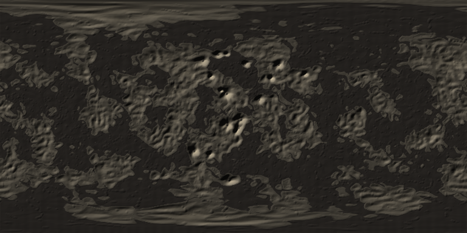
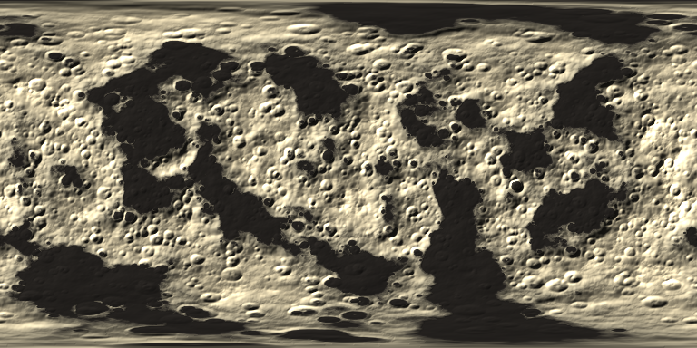
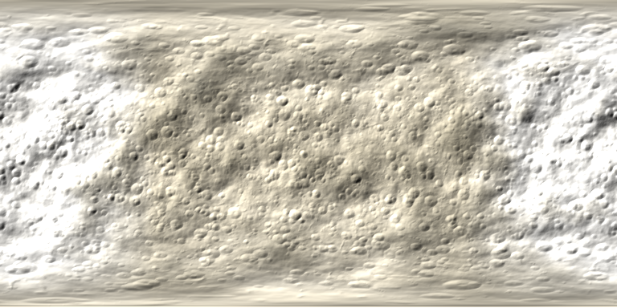
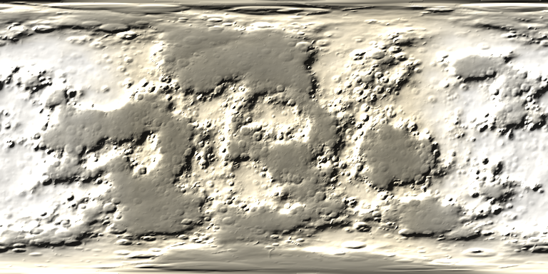

<div align="center">

# Aether

**A distance-accurate exoplanet explorer where every pixel can name its evidence.**

Fly from one astronomical unit to a two-metre observer height on a real exoplanet — with
correct positions, real stellar colours, and an honest label on everything that is inferred
rather than measured.


<sub><i>The TRAPPIST-1 planets. Artist concepts — nobody has ever resolved an exoplanet surface,
and that fact is the whole design problem. NASA/JPL-Caltech, public domain.</i></sub>

</div>

---

## What this is

Three kinds of exoplanet software exist, and none of them do what Aether does.

|                                                  | Strength          | Limitation                            |
| ------------------------------------------------ | ----------------- | ------------------------------------- |
| **Catalogs** — NASA Exoplanet Archive, ExoFOP    | Authoritative     | Tables. No sense of place.            |
| **Visualizers** — OpenSpace, Gaia Sky, NASA Eyes | Correct orbits    | Planets are spheres. You cannot land. |
| **Space games** — No Man's Sky, Elite, KSP       | Immersion, agency | Entirely invented. Zero traceability. |

Aether occupies the empty quadrant: **immersive and auditable at the same time.**

### The claim we make, and the one we refuse

For almost every exoplanet there is no spatially resolved surface observation. Transmission
spectra constrain atmospheres, not geography. Mass and radius constrain a _class_ of
interior, not a coastline.

So Aether does **not** claim to reconstruct a planet's true surface. It claims this instead:

> Aether generates deterministic, physically admissible surface hypotheses conditioned on
> measured system data, retrieval posteriors, interior models, and Solar System analog data.
> Every visible feature is labelled by evidence class and confidence.

The word _accurate_ is reserved for orbits, distances and unit conversions. Generated
geography is **scientifically constrained**, never _accurate_ and never _predicted_.

---

## The central idea: the planet becomes more certain as you observe it


<sub><i>What standing on TRAPPIST-1f might look like. "Might" is doing all the work in that
sentence, and Aether is built to keep saying so. NASA/JPL-Caltech, public domain.</i></sub>

Pick a planet with three measured parameters and the hypothesis envelope is wide: the
surface is a guess, and it is drawn with a strong amber speculation rim to say so. Then add
evidence:

| Add                 | And you gain                                                    |
| ------------------- | --------------------------------------------------------------- |
| **Gaia**            | A stellar distance, so the transit depth becomes a real radius  |
| **Radial velocity** | A mass, therefore density and surface gravity                   |
| **JWST**            | An atmosphere, so the sky colour is derived rather than assumed |

The envelope narrows, hypotheses are eliminated, the world re-composes, and the amber rim
recedes. The discovery loop, the terrain generator, the provenance system and the
uncertainty machinery are not four features — they are one mechanic.

---

## One system, four worlds, generated

These four surfaces were produced by the terrain harness from TRAPPIST-1's published
measurements. Nothing about the geography is observed — no exoplanet surface ever has been —
but nothing about it is arbitrary either. A model selects operators from a fixed catalog, and
physics decides which operators it is even allowed to see.

<table>
<tr>
<td width="50%"><br>
<b>TRAPPIST-1 b</b> · <code>lava_world</code> · 398 K · 4.17 S⊕<br>
<sub>1,833 W/m² of tidal heating — five hundred times Io. Magma ocean, shield volcanoes and
flood basalt. Dark rather than glowing: radiating that flux away settles the surface at 490 K,
far below the basalt solidus.</sub></td>
<td width="50%"><br>
<b>TRAPPIST-1 e</b> · <code>cratered_relict</code> · 250 K · 0.65 S⊕<br>
<sub>Bright cratered highlands cut by dark flood-basalt plains — the lunar maria pattern.
The best-known habitable-zone candidate in the system.</sub></td>
</tr>
<tr>
<td width="50%"><br>
<b>TRAPPIST-1 g</b> · <code>ice_world</code> · 172 K · 0.25 S⊕<br>
<sub>Ice shell, glacial carving and a tidal fracture network over a cratered base.</sub></td>
<td width="50%"><br>
<b>TRAPPIST-1 h</b> · <code>ice_world</code> · 149 K · 0.14 S⊕<br>
<sub>The outermost planet, and the coldest. Hypsometry matched to an icy-satellite reference.</sub></td>
</tr>
</table>

**The archetypes were not assigned by hand.** They fall out of the measured numbers. All four
planets orbit the same 2566 K dwarf at the same age and the same distance from us, so the only
thing separating a lava world from an ice world here is where it sits: 4.17 down to 0.14 times
Earth's illumination. Insolation is derived from TRAPPIST-1's own measured luminosity —
5.55 × 10⁻⁴ L☉ — because assuming a Sun-like host would overstate it a thousandfold and turn
every one of these into a lava world.

**What the model may and may not do.** It picks operators and their parameters from a
registry. It cannot invent a process: rivers are not discouraged on an airless rock, the
operator is absent from the catalog, absent from the JSON schema, and rejected by the
validator if it appears anyway. Parameters outside a physically admissible range are clamped
and the correction is recorded. Every value carries `measured`, `derived`, `assumed`,
`ai_inferred` or `repaired`, so you can always ask which of those a given number was.

Specs are frozen and content-addressed, so the same planet renders the same way every time —
asking twice is a ledger hit, not a second model call.

```bash
# The cards are generated from the seed data, so they are built rather than committed.
pnpm --filter @aether/catalog run export:trappist

cd tools/aether-harness
export OPENCODE_API_KEY=...        # any OpenAI-compatible provider works
python build_incremental.py --cards ../../packages/catalog/trappist-cards.json
```

The Solar System runs through the identical path, and that is the point: it is the only place
with ground truth, so it is where the generator can be shown to be wrong. It currently gets
Mercury and the Moon as airless rock, Venus as a greenhouse at 251 K, Earth capped at 8,850 m
of relief — which is Everest — Mars as a cratered relict, all four giants as volatile
envelopes, and Io as a lava world.

---

## Missions as evidence, not filters


Aether models **fourteen missions**. Each declares its instruments, wavelength coverage, and
— the part that matters — exactly which physical parameters its data can constrain.

Selecting missions is a scientific act. Choose TESS alone and you have a radius ratio and a
period; parameter coverage sits under 25% and the surface is mostly invention. Choose
"everything flying today" and it climbs past 70%.

Two rules keep this honest:

- **Quality is the best across missions, never the sum.** Ticking more boxes cannot
  manufacture confidence.
- **The envelope never fully closes.** Even with every mission selected it bottoms out at
  15%, because no exoplanet surface has ever been resolved. That floor is not pessimism.

The Habitable Worlds Observatory is the only mission that constrains a surface at all — and
even then only weakly, because published work finds ocean and sand nearly indistinguishable
from 0.4–1.8 µm, with a severe degeneracy between planetary radius and surface albedo.

---

## The sky is a map, not a backdrop

The star field is **109,389 real stars at their measured parallax distances**, from the
[HYG database](https://codeberg.org/astronexus/hyg) — Hipparcos for the distances, the Yale
Bright Star Catalogue for the naked-eye sky, Gliese for nearby stars. These are the same
underlying catalogues OpenSpace's Digital Universe star layer is built from.

Two things make it a map rather than a dome:

- **Positions are three-dimensional and real.** The constellations are an accident of our
  viewpoint, and would distort if you travelled far enough. Nothing is painted on a sphere.
- **Brightness is computed, not stored.** Apparent magnitude comes from the distance
  modulus, `m = M + 5·log₁₀(d) − 5`, so approaching a star brightens it by exactly the
  right amount.

Colour runs B−V colour index → effective temperature ([Ballesteros 2012](https://doi.org/10.1209/0295-5075/97/34008))
→ blackbody → sRGB, through the _same_ `stellarColor()` that lights the planets. One
physical model, applied consistently.

The tests check it against the real sky: the brightest star comes out at magnitude −1.46
(Sirius), there are ~8,700 stars brighter than the naked-eye limit against the ~9,000
usually quoted, and the count roughly triples per magnitude step as it should.

Loading is progressive — the naked-eye tier is 170 KB and appears immediately; the full
2.1 MB catalogue streams in behind it.

> **On licensing:** OpenSpace renders from the AMNH Digital Universe atlas, whose
> [licence](https://www.amnh.org/research/hayden-planetarium/digital-universe/download/digital-universe-license)
> requires written permission to redistribute inside software. HYG carries the same science
> from the same sources under CC BY-SA 4.0. Going to the shared upstream is both the more
> permissive route and the better-provenanced one. See
> [`packages/stars/data/ATTRIBUTION.md`](packages/stars/data/ATTRIBUTION.md).

---

## Host stars, at their real colours


Every marker is filled with its star's true blackbody colour, computed by the same
`stellarColor()` function that lights the 3D scene. TRAPPIST-1 at 2566 K really is that
orange, and a world lit by it looks nothing like a world lit by the Sun. We do not correct
for it — an M-dwarf world is genuinely dim, and that is a teaching moment, not a bug.

---

## Architecture

Every package is a building block with one responsibility and no circular dependencies.
Dependencies point strictly downward, so any layer can be replaced without touching the ones
beneath it.

```
apps/
  web/            Three.js client — the only package that knows about rendering

packages/
  catalog/        Typed seed data with provenance -> derived physics -> PlanetModel
  exoplanets/     Every confirmed system, mapped, with priors for what was never measured
  deepsky/        Galaxies, clusters and nebulae (OpenNGC) + derived distances
  stars/          Real star catalogue (HYG) + physical photometry
  solar-system/   Real J2000 elements, Keplerian mechanics, the terrain validation path
  terrain/        Terrain operators + physics admissibility gates + program compilation
  missions/       Mission registry + the evidence model
  physics/        Formula registry + deterministic derivations with full provenance
  schema/         The contract: Science / Inference / Visual layers, LLM containment
  coordinates/    f64 nested reference frames, floating-origin camera, depth partitioning
  units/          SI discipline — branded quantities, IAU/CODATA constants, conversions
```

```
web ──► solar-system ──► terrain ──► physics ──► units
 │                          └──────► schema ───► units
 ├──────► missions ─────────────────────────────► units
 └──────► coordinates ──────────────────────────► units
```

**The renderer has already changed twice** — C++/OpenGL → Babylon.js → Three.js — and the
science layers needed zero rework each time, because everything above `apps/` is written
against the contract rather than against an engine. That line is worth holding.

### Three layers, three permission levels

```ts
interface PlanetModel {
  science: ScienceSpec; // ingestion + allowlisted physics      affects science: yes
  inference: InferenceSpec; // versioned models + prior resolver    affects science: yes, with uncertainty
  visual: VisualSpec; // composer, LLM, texture pipeline      affects science: NO
}
```

The LLM service holds no credential and no schema field that can reach `ScienceSpec`.
Containment is structural, not a system prompt — and there is a test suite that proves it.

### The precision problem

Standing on a planet 40 light-years away spans ~27 orders of magnitude. `float32` gives ~7
significant digits and `float64` gives ~16, so no single linear coordinate system survives
it: subtracting two huge, nearly-equal doubles annihilates the low bits.

Aether never forms the huge numbers. Every frame stores its position _relative to its
parent_, and two frames are related by walking to their lowest common ancestor. A one-metre
offset survives at 40 light-years to better than a nanometre — while the naive
absolute-subtraction approach loses the metre entirely. Both are asserted in
`packages/coordinates/src/precision.test.ts`.

---

## Quick start

```bash
git clone https://github.com/Hussaincodes01/Aether-Space-Program.git
cd Aether-Space-Program
pnpm install
pnpm dev            # http://localhost:5173
```

### Node 22+

Requires **Node 22 or newer** and **pnpm 9+**. The floor is enforced rather than suggested:
`.npmrc` sets `engine-strict=true`, so `pnpm install` fails immediately and by name on an
older Node instead of producing a tree that breaks later in a confusing place.

```bash
nvm use            # reads .nvmrc
node --version     # must be >= 22
corepack enable    # pnpm at the exact version in packageManager
```

| Command             | What it does                                           |
| ------------------- | ------------------------------------------------------ |
| `pnpm dev`          | Run the client at http://localhost:5173                |
| `pnpm check`        | Lint + typecheck + test + build — exactly what CI runs |
| `pnpm lint`         | ESLint across every package and the client             |
| `pnpm format`       | Rewrite with Prettier                                  |
| `pnpm format:check` | Fail if anything is unformatted (CI runs this)         |
| `pnpm typecheck`    | `tsc --noEmit` everywhere                              |
| `pnpm test`         | Vitest across every package and the client             |
| `pnpm build`        | Build every package **and** the web client             |
| `pnpm build:web`    | Client only                                            |
| `pnpm test:browser` | Smoke-test the built client in headless Chromium       |

**Controls:** `W A S D` move · `R` / `F` up and down · `Shift` boost · mouse wheel throttle ·
`Esc` release the mouse.

**Panels:** `C` catalog · `P` provenance · `B` Solar System bodies · `K` interstellar map ·
`M` missions · `G` precision overlay · `U` hide everything and fly.

Watch the **local coords** readout in the HUD. It stays small no matter how far the camera
is from the origin — that is frame rebasing doing its job. If it ever climbs past ~1e12 m,
the f32 upload will start to jitter and something has broken.

---

## Start at home

`pnpm dev` puts you in **low Earth orbit**, on today's date. Every planet sits on its real
Keplerian orbit, advanced from the JPL approximate elements — orbital periods reproduce the
published values to better than 0.1%, and to 0.01% for the terrestrial planets.

That starting point is not sentiment. **The Solar System is the only place the generator can
be checked against ground truth.** Nobody has resolved an exoplanet surface, but we have
maps of Mars. So the test suite asserts that feeding real parameters into the operator gates
reproduces worlds we have actually visited:

| World       | What the gates must produce                | Why                                                                       |
| ----------- | ------------------------------------------ | ------------------------------------------------------------------------- |
| **Moon**    | Craters. No wind, water or ice erosion.    | Airless, 0 Pa                                                             |
| **Mars**    | Dunes and craters, but **no rivers today** | 6 mbar sustains the largest dune fields known; liquid water is not stable |
| **Earth**   | Rivers, dunes and ice                      | 1 bar, stable water, 71% ocean                                            |
| **Jupiter** | **No solid surface at all**                | 1326 kg/m³ — nothing to stand on, and nothing to hold a crater            |

If Mars came out as an ocean world, the rules would be wrong — and no amount of exoplanet
work would ever have revealed it. Every exoplanet this project renders inherits its
credibility from whether Mars looks like Mars.


<sub><i>All seven TRAPPIST-1 planets orbit closer than Mercury. NASA/JPL-Caltech, public domain.</i></sub>

## Status

Everything below is in the repository, tested, and building. **555 tests** across twelve
packages, plus a browser smoke test in CI; `pnpm check` runs lint, typecheck, tests and the
full build.

### The pipeline is connected end to end

```
catalog seed  ->  SI + provenance  ->  mission evidence gate  ->  physics derivations
              ->  inference for the gaps  ->  terrain hypothesis  ->  visual parameters
```

`buildPlanetModel(systemId, planetId, evidenceProfile)` produces every number the renderer
uses, and each one can name its own origin. See
[`docs/catalog-ingestion.md`](docs/catalog-ingestion.md).

### Working today

- ✅ f64 hierarchical frames, floating-origin camera, rebasing with hysteresis
- ✅ **Typed catalog** — TRAPPIST-1 (all seven), Proxima Centauri b, Sun/Earth/Mars. Every
  value names its unit and a source that must resolve, or ingestion fails
- ✅ **Earth as the pipeline's own unit test** — density 5514 kg/m³, gravity 9.80 m/s²,
  escape velocity 11.19 km/s, insolation 1361 W/m², equilibrium temperature 254 K
- ✅ Physics registry — equilibrium temperature, insolation, density, gravity, escape
  velocity, scale height, Jeans parameter, Kopparapu habitable zone, blackbody colour
- ✅ Three-layer contract with structurally enforced LLM containment
- ✅ **Resolver enforces its own contract** — dimensional compatibility and physical domain
  checked on every value, rejections reported rather than swallowed
- ✅ **Terrain validates by construction** — one entry point that cannot be bypassed, typed
  errors in strict mode, unknown operators and parameters recorded
- ✅ Terrain operators with physics gates and height evaluation — craters with rims and
  ejecta, shield volcanoes, fracture networks, dune fields, valley incision, ice caps
- ✅ **Provenance inspector** (P) — six badges, unknowns rendered rather than dropped,
  processes ruled out listed beside those present
- ✅ **Catalog panel** (C) with per-planet measured/unknown counts under the current missions
- ✅ **Precision overlay** (G) — frame, local coordinates, rebase flag, f32 limit warning
- ✅ Rayleigh/Mie atmospheric scattering, coefficients derived from mean molecular weight
- ✅ Real Solar System — 33 bodies: the Sun, eight planets, five dwarf planets and 19 moons,
  ring systems. Every orbit validated against published sidereal periods
- ✅ **Real sky**: 109,389 stars at measured parallax distances from HYG
- ✅ **Deep sky**: 12,160 galaxies, clusters and nebulae from OpenNGC
- ✅ **Every confirmed exoplanet**: 6,309 planets in 4,722 systems, mapped
- ✅ **Interstellar travel**: search any of the 4,722 systems and go there
- ✅ Typed errors surfaced in the UI, plus a WebGL 2 pre-flight check

### Honest limitations

These are real and stated rather than buried:

| Limitation                             | Detail                                                                                                                                                                                                                                                                                             |
| -------------------------------------- | -------------------------------------------------------------------------------------------------------------------------------------------------------------------------------------------------------------------------------------------------------------------------------------------------- |
| **Depth partitioning is opt-in**       | `?depth=partitioned` works and is tested, but four full scene passes have not been measured on real hardware from this environment. The default remains the single-pass logarithmic buffer, which has been looked at on a screen. See [`docs/rendering-precision.md`](docs/rendering-precision.md) |
| **Reversed-Z is built, not wired**     | Three.js does not expose the depth clear and comparison controls to drive it through its standard path                                                                                                                                                                                             |
| **The typed catalog is three systems** | The 4,722-system map is separate and shallower: names, distances, positions. Only catalog systems have a full interrogable model                                                                                                                                                                   |
| **One inference prior**                | Chen & Kipping mass-radius. Enough for Proxima b; not a full inference layer                                                                                                                                                                                                                       |
| **No LLM composer yet**                | The containment boundary is built and tested. Nothing is plugged into it                                                                                                                                                                                                                           |
| **Browser checks cover two stops**     | CI drives the built client in headless Chromium with software WebGL: launch at Earth, then arrival at TRAPPIST-1, checking for a lit frame, the right light source, the starlight readout and f32 precision. No surface descent yet, and software rendering says nothing about real frame rates    |
| **Terrain is uncalibrated**            | The gates reproduce the Solar System qualitatively. Nothing yet scores generated terrain against real Mars or Moon maps                                                                                                                                                                            |

### Further reading

| Document                                                     | Covers                                                             |
| ------------------------------------------------------------ | ------------------------------------------------------------------ |
| [`docs/provenance.md`](docs/provenance.md)                   | The data model, unit/domain checking, the resolution chain, badges |
| [`docs/catalog-ingestion.md`](docs/catalog-ingestion.md)     | Seed data rules, the pipeline, determinism, adding a system        |
| [`docs/mission-evidence.md`](docs/mission-evidence.md)       | What mission selection may and may not change                      |
| [`docs/terrain-safety.md`](docs/terrain-safety.md)           | Gates, warnings, strict mode, why terrain cannot affect physics    |
| [`docs/rendering-precision.md`](docs/rendering-precision.md) | f64 frames, the f32 limit, depth strategies                        |
| [`docs/PRD.md`](docs/PRD.md)                                 | The original specification                                         |

### About that terrain

Earth's entire relief — Everest to the Mariana Trench — is about 20 km on a 6371 km radius.
**That is 0.3%.** At true scale a terrestrial planet is smoother than a billiard ball, and
every "realistic" planet you have seen rendered is vertically exaggerated, usually by one to
two orders of magnitude, silently.

Aether exaggerates too, because a perfect sphere teaches nothing. The difference is that the
multiplier is a `VisualSpec` value, it is displayed in the HUD next to the true relief, and
setting it to `1` shows you the honest answer.

**Known limitation, recorded rather than hidden:** the terrain operator set does not yet
model the consequences of tidal locking, so Earth and TRAPPIST-1e compile to the most
similar worlds in the catalog. There is a test pinning that distance so it cannot quietly
drift downward. Adding a tidal-locking operator is the top item in the backlog.

---

## Contributing

New contributors: start with **[CONTRIBUTING.md](CONTRIBUTING.md)**. It explains the three
registries, how to add a feature by writing exactly one file, and the two invariants that
must never break.

The short version: adding a physics formula, a terrain operator or a mission means creating
one file and adding one export line. No switch statements, no dispatch tables.

---

## Credits and licence

Imagery is NASA/JPL-Caltech, public domain. The Hertzsprung–Russell diagram and the mission
timeline are generated for this project.

Scientific method draws on the NASA Exoplanet Archive, the MALBEC radiative-transfer
intercomparison, the Kopparapu habitable-zone parameterisation, Zeng et al. mass–radius
relations, and published work on surface degeneracies in reflected-light observations. Full
citations are in [`docs/PRD.md`](docs/PRD.md).

This project uses NASA data and imagery. It is **not** endorsed by or affiliated with NASA,
ESA, or any space agency.

> **Every export and screenshot carries this, burned into the framebuffer:**
> _Data-grounded artistic reconstruction. Geography is procedurally generated and is not an
> observation._
