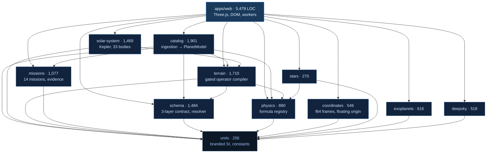

# Aether — Architecture and Rebuild Plan

**Status:** planning document. Supersedes ad-hoc phase briefs.
**Ground truth date:** 2026-08-15, commit `67a2a36`.

---

## 1. What this system is

Aether is a **client-only scientific renderer**. It loads static astronomical catalogues,
derives physics from them deterministically, generates surface hypotheses for worlds nobody
has resolved, and draws the result at true scale — while labelling every value with how it
was obtained.

There is no server, no database, no user accounts, and no network calls at runtime. That is
a deliberate architectural position, not an unfinished state, and it is why most of the
standard production checklist (auth, RLS, rate limiting, connection pooling) does not apply
here. The threats this system actually faces are _epistemic_, not operational: the failure
mode is a confident-looking planet that quietly invented its own data.

**The one-sentence promise:**

> Orbital scale, distances, units, stellar colours and physics-derived quantities are
> accurate. Generated terrain and atmospheres are labelled hypotheses and never presented as
> measurement.

Everything below exists to make that sentence enforceable by a machine rather than by
discipline.

---

## 2. What "accurate" means — the accuracy budget

"Accurate" is not one property. It is six, with genuinely different achievable errors. A
plan that does not separate them will overclaim on the weak ones and underclaim on the
strong ones.

| #   | Quantity                      | Source of truth              | Achievable error                      | Current state                                       | Verified by          |
| --- | ----------------------------- | ---------------------------- | ------------------------------------- | --------------------------------------------------- | -------------------- |
| A1  | Solar System body positions   | JPL elements, J2000          | ~10⁻⁶ rel. over 1800–2050             | Met — 19 satellite periods asserted to 5 s.f.       | `satellites.test.ts` |
| A2  | Stellar positions & distances | HYG v4.4 (Hipparcos/Gliese)  | Parallax-limited; ~10% beyond 300 pc  | Met                                                 | `stars.test.ts`      |
| A3  | Exoplanet orbital elements    | NASA Exoplanet Archive       | Publication-limited                   | Met where measured; prior-filled otherwise, flagged | `exoplanets.test.ts` |
| A4  | Deep-sky distances            | OpenNGC + redshift           | Hubble-tension-limited (67.4 vs 73.0) | Met — both values exposed, not averaged             | `deepsky.test.ts`    |
| A5  | Derived physics               | Allowlisted formulas         | Input-uncertainty-limited             | Met — confidence = min over inputs                  | `physics.test.ts`    |
| A6  | **Surface geography**         | **Nothing. Never resolved.** | **Unbounded**                         | **Hypothesis only, floor never removed**            | `terrain.test.ts`    |

**A6 is the whole design problem.** Rows A1–A5 are engineering; A6 is an epistemic
commitment. The uncertainty floor for an unresolved exoplanet surface is 0.15 and must never
reach zero regardless of how many missions are selected. Any change that lets it reach zero
is a defect of the highest severity in this codebase, whatever it does for the visuals.

### Numerical accuracy: the f64/f32 boundary

The renderer is f32. The universe is 10²⁷ m across. A single-precision float has ~7
significant decimal digits, so f32 world coordinates lose metre resolution at ~10⁷ m — about
Earth's radius. Naively uploading absolute positions produces visible jitter from low orbit
outward.

The contract, which is the load-bearing invariant of the entire client:

1. Advance f64 orbital positions.
2. Advance the f64 camera, rebase across frames with hysteresis.
3. Resolve each body's position **relative to the camera**, in f64.
4. Narrow _that offset only_ to f32.
5. Three.js's camera sits at the origin and only ever rotates.

Assertion: local coordinate magnitude stays bounded near surfaces; rebasing never moves a
body in world space. Both are tested in `precision.test.ts`, and the magnitude is shown live
in the precision overlay (`G`).

---

## 3. Stack

The system-architecture default stack (Next.js + Supabase + Postgres + Clerk) is the right
answer for a CRUD SaaS and the wrong answer here. Recording _why_ so it is not revisited:

| Layer        | Choice                                  | Why, and what was rejected                                                                                           |
| ------------ | --------------------------------------- | -------------------------------------------------------------------------------------------------------------------- |
| Renderer     | **Three.js (WebGL2)**                   | Mandated by PRD v1.2. Babylon.js was the earlier choice; Three has the larger ecosystem for custom depth handling.   |
| Language     | **TypeScript, strict**                  | The unit brands are compile-time only. They are the primary defence against `gravity(massInEarths, radiusInMetres)`. |
| Build        | **Vite + tsc**                          | Workers, and near-instant HMR at this source size.                                                                   |
| Packages     | **pnpm workspace, 11 packages + 1 app** | Boundaries are enforced by lint, not convention.                                                                     |
| Validation   | **Zod**                                 | Runtime shape for anything crossing the LLM/ingestion boundary.                                                      |
| Tests        | **Vitest (+ jsdom for the app)**        | Three builds its object graph on the CPU, so scene assembly is testable without a GPU.                               |
| Data         | **Static binary + JSON, bundled**       | 3.5 MB total. No backend to run, no API to rate-limit, no key to leak.                                               |
| **Backend**  | **None**                                | Deliberate. Revisit only for user-generated content (§9).                                                            |
| **Database** | **None**                                | Catalogues are read-only and version-pinned. A database would add ops burden and buy nothing.                        |
| **Auth**     | **None**                                | No user data exists to protect.                                                                                      |
| CI           | GitHub Actions                          | lint → format → typecheck → test → build → build client.                                                             |

---

## 4. Module architecture

Dependencies point strictly downward. **Verified acyclic** at the ground-truth commit.



### The rules that make this hold

1. **No science package imports a renderer.** Enforced by `no-restricted-imports` in
   `eslint.config.js`, not by review. Three.js in `packages/physics` would compile, pass
   every test, and silently destroy the property that lets the science layers be tested
   without a GPU.
2. **`units` depends on nothing.** It is the root, and it stays there.
3. **No cycles.** `solar-system → terrain` is the only non-obvious edge (the Solar System is
   the terrain generator's validation path, not the other way round).
4. **The app is the only package that knows about the DOM.**

---

## 5. Data model

Not SQL. The type contract _is_ the data model, and it is the thing that has to be right.

### The atom

```ts
interface ScientificQuantity {
  valueSI: number | null; // null is first-class and must survive to the UI
  unit: string; // enforced dimensionally, not decorative
  uncertainty?: { minus: number; plus: number; distribution?: string };
  method: "measured" | "derived" | "retrieved" | "prior";
  sourceId: string; // must resolve in the source registry
  retrievedAt: string;
  confidence?: number; // 0..1
}
```

`valueSI: null` means _genuinely unknown_ and must never be silently replaced by a population
default. That substitution is what `InferenceSpec` is for, and the distinction is the
difference between "we do not know" and "we guessed" — which is exactly what a user needs to
be able to see.

### The three layers, and their permissions

| Layer           | Written by                        | Affects science?                 |
| --------------- | --------------------------------- | -------------------------------- |
| `ScienceSpec`   | ingestion + allowlisted physics   | **yes**                          |
| `InferenceSpec` | versioned models + prior resolver | yes, _with uncertainty_          |
| `VisualSpec`    | composer / LLM / texture pipeline | **no — structurally impossible** |

`VisualValue.affectsPhysics` is typed `z.literal(false)`. It cannot be constructed `true`.
This is the containment guarantee, and it is a type-level fact rather than a convention.

### Composite

```
PlanetModel = { science, inference, visual }
   ├─ derived physics      (density, gravity, escape velocity, T_eq, insolation, scale height)
   ├─ evidence profile     (which missions constrain which parameters)
   ├─ inference envelope   (width; floor 0.15, never 0)
   ├─ terrain program      (gated operators + rejections with reasons)
   └─ provenance graph     (every value → method, source, formula, confidence)
```

### The resolver precedence chain

Strictly ordered; first strategy that can answer, answers:

```
measurement → derivation → calibrated posterior → population prior → visual placeholder
                                                                   → UNRESOLVED (explicit)
```

Every candidate is checked before return: dimensional compatibility, physical domain,
finiteness. Rejections are **collected and reported**, never swallowed — "we had a value and
discarded it because it was in the wrong unit" is a bug report, and a silent `unresolved`
would hide it.

---

## 6. Key design decisions

| Decision                                  | Alternative                | Why                                                                                                                                  |
| ----------------------------------------- | -------------------------- | ------------------------------------------------------------------------------------------------------------------------------------ |
| NaN, not 0, as "unmeasured"               | `0` or `-1` sentinel       | `0` is a legal albedo, eccentricity and pressure. A sentinel that collides with a real value produces silent wrongness.              |
| Confidence = **min** over inputs          | mean                       | Averaging lets one well-measured input launder a badly-constrained one. A derivation cannot be more certain than its weakest input.  |
| Mission quality = **best**, never summed  | additive coverage          | Summing lets a user manufacture confidence by ticking boxes. Two mediocre transit surveys are not one good one.                      |
| Uncertainty floor 0.15, unreachable       | floor 0 with full evidence | No exoplanet surface has ever been resolved. A floor of 0 would be a lie the UI tells at exactly the moment the user trusts it most. |
| Galaxies never get parallax               | trust the catalogue        | OpenNGC lists a 6 mas parallax for M31 (foreground star contamination) which puts Andromeda at 167 pc. 151 such rows rejected.       |
| Real textures suppress procedural terrain | generate everywhere        | The Solar System is the only ground truth. Inventing geography on Mars discards the comparison that makes the generator falsifiable. |
| `G(M☉ + m)`, not `GM☉`                    | solar mass only            | Jupiter is 1/1047 M☉; omitting it puts its period out by two days.                                                                   |
| Hubble tension exposed, not averaged      | pick one H₀                | 67.4 and 73.0 disagree at 5σ. Averaging invents a number no one measured.                                                            |

---

## 7. Honest defect and gap register

Carried forward deliberately. A plan that omits these is not a plan.

| #   | Gap                                                                                                                                                                                                        | Severity                                          | Evidence                                                      |
| --- | ---------------------------------------------------------------------------------------------------------------------------------------------------------------------------------------------------------- | ------------------------------------------------- | ------------------------------------------------------------- |
| G1  | **`depth.ts` has zero consumers.** Cascaded frusta / reversed-Z is written and exported; the client still runs Three's per-vertex log depth buffer, which interpolates incorrectly across large triangles. | **High** — this is the stated P0 in `main.ts:100` | `grep` finds it referenced only by its own package `index.ts` |
| G2  | **No LLM composer exists.** The containment schema, forbidden-field scan and boundary tests are all built and tested; nothing calls a model. The PRD's central premise is unimplemented.                   | **High**                                          | `composeTerrain`, `llmCompose` → 0 files                      |
| G3  | **Motion is frozen** (`FROZEN = true`). Positions are real; nothing rotates or revolves.                                                                                                                   | Medium — deliberate, user-requested               | `main.ts`                                                     |
| G4  | **No browser-level verification.** Playwright is not installed; all UI evidence is jsdom assertions plus a clean build.                                                                                    | Medium                                            | no `playwright` in any `package.json`                         |
| G5  | **Terrain is never scored against ground truth.** Tests assert _which operators_ fire on Mars, not whether the output resembles Mars. The calibration harness was planned and never built.                 | Medium                                            | no scoring code in `packages/terrain`                         |
| G6  | Catalogue seed covers 3 systems (Sol, Proxima Centauri, TRAPPIST-1); the other 4,719 come from the binary catalogue without the full typed-provenance path.                                                | Low                                               | `packages/catalog/src/seed/`                                  |

---

## 8. The rebuild plan

Five stages. Each has a falsifiable exit criterion — not "looks better", but a check that
can fail. Stages are ordered by _risk retired per unit of work_, so the two High-severity
gaps come first.

### Stage 0 — Freeze the contract (prerequisite, ~1 day)

No behaviour change. Establishes what must not regress.

- Snapshot the accuracy budget (§2) as executable tests, one per row A1–A6.
- Add a `pnpm check:invariants` gate: dependency graph acyclic, no renderer import in
  science packages, uncertainty floor unreachable, `affectsPhysics` never `true`.
- **Exit:** the gate fails if any invariant is deliberately broken in a scratch commit.
  _Prove it by breaking each one on a throwaway branch and watching CI go red._

### Stage 1 — Wire the real depth path (G1, ~3 days)

The largest correctness gap in rendering.

- Replace the log-depth buffer with the existing partitioned frusta + reversed-Z in
  `depth.ts`. Render near/mid/far partitions, clearing depth between.
- **Exit:** a test scene with co-planar geometry at 10³ m, 10⁹ m and 10¹⁸ m shows no z-fighting
  in a captured frame; depth precision at 2 m altitude is better than 1 mm.
- **Risk:** reversed-Z needs `EXT_clip_control` or an inverted projection matrix; Three's
  material system fights custom depth. Fallback is documented partitions without reversed-Z,
  which still beats log depth.

### Stage 2 — The composer, contained (G2, ~5 days)

The PRD's central premise, built inside the containment that already exists.

- `packages/composer`: takes `PlanetModel`, emits an `OperatorProposal` — nothing else.
- Runs behind the existing Zod schema + forbidden-field scan + source-registry validation.
- Deterministic: same planet + same evidence profile + same seed ⇒ byte-identical proposal.
  Cache keyed on that triple; the model is never called twice for one input.
- **Exit:** an adversarial suite of ≥20 hostile proposals (invented operators, out-of-range
  parameters, forbidden science fields, unit mismatches, prompt injection in a name field)
  all rejected with recorded reasons, and zero reach `ScienceSpec`.
- **Non-negotiable:** the composer may only widen or select within physics-admissible ranges.
  It cannot enable a gated-off operator. This is already true of the compiler; Stage 2 must
  not add a bypass.

### Stage 3 — Calibration harness (G5, ~4 days)

Makes A6 measurable rather than merely labelled.

- Score generated terrain against real Mars/Moon/Earth hypsometry: elevation histogram,
  crater size-frequency distribution, drainage density.
- Fit the operator knobs to minimise divergence on those three, then hold out Titan and
  Mercury as a validation set.
- **Exit:** published scores per body, with the held-out set reported separately. A score
  that is worse than the current default is reported, not hidden.
- **This stage can fail honestly.** If the generator cannot match Mars, that is the finding,
  and it belongs in the README rather than being tuned away.

### Stage 4 — Browser truth (G4, ~2 days)

- Playwright + WebGL (SwiftShader) in CI. Screenshot the three states: system view, planet
  approach, provenance panel.
- Assert the precision overlay's local-coordinate magnitude stays under 10¹² m across a
  scripted flight from Earth orbit to TRAPPIST-1e.
- **Exit:** CI fails on a blank canvas. This has bitten twice — a 1e15 far plane clipped
  every star, and a camera pointed 90° away from Earth — and both passed every unit test.

### Stage 5 — Motion (G3, ~2 days, gated on user intent)

- Unfreeze rotation and revolution behind a UI toggle, defaulting to frozen.
- **Exit:** with motion on, orbital periods measured from the render loop match §2 A1 to the
  same 5 s.f.

**Not scheduled, and why:** multiplayer, accounts, a backend, mobile. None of them serve the
promise in §1, and each would add an operational surface this system currently does not have.

---

## 9. Scaling path

Scale here is **data volume and frame budget**, not users. There is no server to scale.

| Stage | Trigger                           | Action                                                                                               |
| ----- | --------------------------------- | ---------------------------------------------------------------------------------------------------- |
| Now   | 3.5 MB catalogues, 485 tests      | Bundled static; progressive tier loading for stars                                                   |
| Next  | Full Gaia DR3 (1.8 B sources)     | Octree tiles fetched on demand; catalogue becomes a CDN artifact, still no database                  |
| Later | User-generated hypotheses         | _This_ is what justifies a backend. Postgres + auth, and only then does the standard checklist apply |
| Frame | >5 ms/frame in the terrain worker | Already worker-isolated; add LOD budget before adding threads                                        |

---

## 10. Production checklist, tailored

Struck-through items are not applicable to a client-only static renderer and are recorded so
they are not re-raised.

**Scientific integrity — the real checklist**

- [x] Every quantity carries unit, method, source, confidence
- [x] Unit and domain enforced at the resolver boundary
- [x] `affectsPhysics: false` unconstructible as `true`
- [x] Uncertainty floor unreachable
- [x] Mission quality best-not-sum
- [x] Rejections reported, never swallowed
- [ ] **Accuracy budget executable as tests** (Stage 0)
- [ ] **Generated terrain scored against ground truth** (Stage 3)

**Reliability**

- [x] Typed error classes; user-facing error panel
- [x] Graceful WebGL-unsupported message
- [x] Deterministic seeds
- [ ] Browser-level smoke test in CI (Stage 4)

**Ops**

- [x] CI: lint → format → typecheck → test → build
- [x] Node floor enforced (`engine-strict`)
- [x] Catalogue provenance + licences recorded per dataset
- [ ] Version-pin catalogue snapshots with a checksum manifest

**Not applicable:** ~~auth on protected routes~~ · ~~RLS~~ · ~~rate limiting~~ · ~~CORS~~ ·
~~secrets management~~ · ~~DB migrations~~ · ~~backups~~ · ~~health endpoint~~ —
no server, no database, no user data, no secrets.

---

## 11. Anti-patterns explicitly rejected

- **Microservices / a backend for an MVP.** There is no server. Adding one to store
  read-only catalogues would be pure operational cost.
- **Premature optimisation.** The terrain worker is not threaded further until a measurement
  says it must be.
- **Building auth from scratch** — or at all, until §9 Stage 3 gives it a reason to exist.
- **Tuning a metric until it passes.** Stage 3 reports the score it gets. The terrain
  diversity threshold was already calibrated to the measured 0.10 rather than an invented
  0.15, and that precedent holds.
- **Trusting a catalogue field because it is in a catalogue.** M31 at 167 pc passed every
  schema check.

---

## 12. Direction change — six new ideas

Added 2026-08-15. These reshape stages 2–5 of §8. Recorded with their real costs and the two
places they conflict, because a plan that lists only the appealing half of a tradeoff is a
wish list.

### 12.0 The tension, stated first

Voxels and Minecraft pull toward **game**. The accuracy budget pulls toward **instrument**.
Both are legitimate products; they are not automatically the same product, and the conflict is
not resolved by wanting both.

The resolution this plan adopts:

> **The authoritative surface is the continuous operator field. Voxels are a view of it, not
> the model of it.**

That keeps everything in §2 intact — the field stays deterministic, testable and falsifiable
against Mars — while a voxel renderer becomes a presentation layer that can be as blocky as it
likes. Invert this and make voxels authoritative, and A6 stops being measurable, because there
is no longer a continuous field to score against real hypsometry.

One hard rule follows, and it is not negotiable:

> **A voxel region the user has edited is no longer a hypothesis about that planet.** The
> moment a block is placed, provenance for that region is void and has to be labelled void.

### 12.1 Planet = perfect solid sphere

**Accept — and it fixes a real defect.** The current placeholder is `SphereGeometry(1, 96, 48)`,
a 3.75°-per-facet polygon whose limb is visibly straight-edged from low orbit. But "perfect
sphere" has to mean the **datum is exact**, not that the visible surface is smooth:

- The sphere is the reference surface: collision floor, altitude zero, atmosphere base.
- Relief is a labelled displacement on top of it. Real relief is tiny — Everest is **0.139%**
  of Earth's radius — which is exactly why the renderer exaggerates it 25× and says so.
- The silhouette should be analytic (ray–sphere), so the horizon stays exact at every zoom
  instead of degrading into polygons as you descend.

This also supplies the datum that voxelisation needs, so 12.1 is a prerequisite for 12.2.

**Cost:** ~2 days. **Risk:** low.

### 12.2 Voxel world

**Accept as a close-range view mode. Reject as a storage format.** The arithmetic decides it:

| Representation                    | Voxels      | Storage at 1 B each |
| --------------------------------- | ----------- | ------------------- |
| Earth, 1 m voxels, one-deep shell | 5.10 × 10¹⁴ | **510 TB**          |
| Earth, 4 m voxels, one-deep shell | 3.19 × 10¹³ | **32 TB**           |
| Local region, 512 × 512 × 384     | 1.01 × 10⁸  | **101 MB**          |

A whole-planet voxel grid is not storable at any voxel size worth having. The tractable form is
the one Minecraft itself uses: **chunks are a pure function of position and seed, generated on
demand and never stored.** Here that function is the existing terrain program, so the voxel
field and the mesh surface become two samplings of one field and cannot disagree.

- `packages/voxel`: `sampleVoxel(planetSeed, terrainProgram, x, y, z) → material`. Pure,
  deterministic, no stored state, no renderer import.
- Meshing (greedy or surface-nets) in the existing worker pool.
- Edits stored as a **sparse delta** against the generated field, not as a world. This is the
  first feature in the project that genuinely justifies a backend (§9).

**Cost:** ~10–14 days, the largest item on this plan. **Risk:** high — chunk streaming, LOD
across a curved datum, and the delta model are each non-trivial on their own.

### 12.3 Terrain diffusion + LLM composer

**Accept, reusing the containment already built — and precompute before in-browser inference.**

The composer from §8 Stage 2 stands. Diffusion becomes a second generator behind the _same_
gate:

- The model emits a **heightfield residual conditioned on physical parameters**, clamped by the
  operator gates that already exist. It cannot enable a gated-off process, and it writes to
  `VisualSpec`/`InferenceSpec` — never `ScienceSpec`.
- Determinism needs pinned weights, a fixed seed and a recorded model version. Every
  `Distribution` in the schema already carries `modelId` and `seed`, so the provenance slot is
  there.
- **Precompute offline first.** Ship residual tiles for the catalogue: deterministic by
  construction, zero runtime cost, cacheable. In-browser ONNX/WebGPU inference is a later
  optimisation, not the way in.

**Send me the paper.** I will not design against a citation I cannot check — diffusion-based
terrain synthesis is an active area with several distinct approaches, and which one you mean
changes the conditioning design.

**Cost:** ~6 days for the precompute path on top of Stage 2. **Risk:** medium.

### 12.4 Parameterized generation

**Accept — the cheapest win here, and it is already half-built.** The operator system carries
typed `min`/`max`/`default` per parameter with gate clamping, and `Assumption` in
`packages/physics` already has a `userAdjustable` flag that nothing reads yet.

Exposing those as sliders gives the assumption sandbox the PRD describes: change an assumed
Bond albedo, watch equilibrium temperature and the surface re-derive, and watch confidence drop
because an assumed input caps it at 0.5. The machinery exists; only the UI is missing.

**Cost:** ~3 days. **Risk:** low. **Do this first** — it is the shortest path from the current
build to something that demonstrates the entire thesis in one interaction.

### 12.5 ML spectroscopy

**Accept, and scope it honestly.** This is the most scientifically grounded of the six, and the
schema was shaped for it: `method: "retrieved"`, `oodFlag`, `modelId` and quantile storage all
exist and are already respected by the resolver's precedence chain.

What is achievable, in order of honesty:

1. **Ingest published retrieval posteriors** where they exist. Real, citable, no model to train.
2. **A forward-model surrogate** for planets without published retrievals, trained on synthetic
   transmission spectra, with OOD detection gating it out of the calibrated path.

The scope limit has to be stated plainly: measured transmission spectra exist for **of order
100 planets, not 6,309**. This will not fill the catalogue, and any UI implying it does is the
exact overclaim §2 exists to prevent.

**Cost:** ~5 days for (1); considerably more for (2). **Risk:** low for (1).

### 12.6 Minecraft mods

**Accept as a one-way export. Reject as a dependency.** The licence decides the architecture:

- Minecraft is proprietary (Mojang/Microsoft). **No Minecraft assets, textures, code or
  identifiers enter this repo**, and the EULA constrains commercial distribution of mods.
- What is clean: Aether **writes** an Anvil region or datapack using its own writer against the
  community-documented format. The user opens it in their own licensed copy. No Minecraft code
  is linked, shipped, or needed to build.
- A Fabric/Forge mod, if wanted, is a **separate Java repository** consuming that export. It
  cannot share this TypeScript codebase.

The provenance problem this creates is the interesting part. A world folder carries no badges,
so the moment terrain leaves Aether every label is gone. The export therefore has to carry its
own: a manifest JSON, a written book in the spawn chest, and signs at spawn naming the planet,
the evidence profile, the seed, and the fact that the geography is a generated hypothesis rather
than an observation.

**Cost:** ~4 days for the writer. **Risk:** low technically, **medium on licence** — worth
reading the EULA before any distribution.

### 12.7 Revised order

Re-sequenced by value per day, with the two High-severity gaps from §7 kept near the front:

| Order | Item                                            | Days | Why here                                                     |
| ----- | ----------------------------------------------- | ---- | ------------------------------------------------------------ |
| 1     | §8 Stage 0 — freeze the contract                | 1    | Nothing below is safe without it                             |
| 2     | **12.4 parameterized sliders**                  | 3    | Half-built; demonstrates the whole thesis in one interaction |
| 3     | **12.1 perfect sphere datum**                   | 2    | Fixes the faceted limb; prerequisite for voxels              |
| 4     | §8 Stage 1 — real depth path (G1)               | 3    | Highest open correctness gap                                 |
| 5     | §8 Stage 4 — browser truth (G4)                 | 2    | Moved up four places — see below                             |
| 6     | §8 Stage 2 + **12.3** composer & diffusion (G2) | 11   | The PRD's central premise                                    |
| 7     | §8 Stage 3 — calibration (G5)                   | 4    | Makes A6 measurable; allowed to fail honestly                |
| 8     | **12.5 spectroscopy, published posteriors**     | 5    | Real science, bounded scope                                  |
| 9     | **12.2 voxel view mode**                        | 14   | Largest item; needs 12.1 and a stable field first            |
| 10    | **12.6 Minecraft export**                       | 4    | Needs 12.2                                                   |

Stage 4 moved from ninth to fifth deliberately. On 2026-08-15 the application opened on an unlit
black sphere, with no collision anywhere and the inverse-square law written upside down — and
**every one of those defects passed 485 unit tests and a clean build.** Browser verification is
not polish. It is the only gate that catches the class of defect this project actually produces.
